# Financial Analysis Platform

A quantitative and fundamental financial market analytics system designed for multi-asset monitoring, technical indicator calculation, valuation metric tracking, and automated market intelligence.

---

## 1. Market Monitoring & Price Action Charts
Interactive, high-frequency price charts across customizable timeframes with multi-scale historical tracking and candlestick overlays:

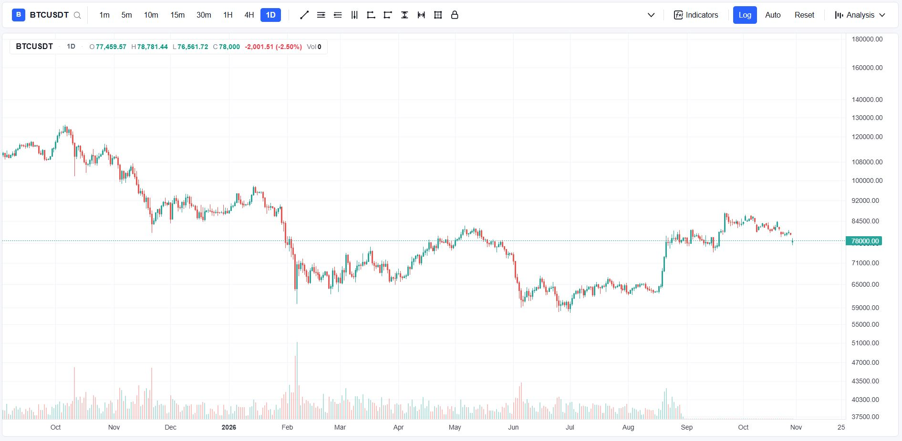
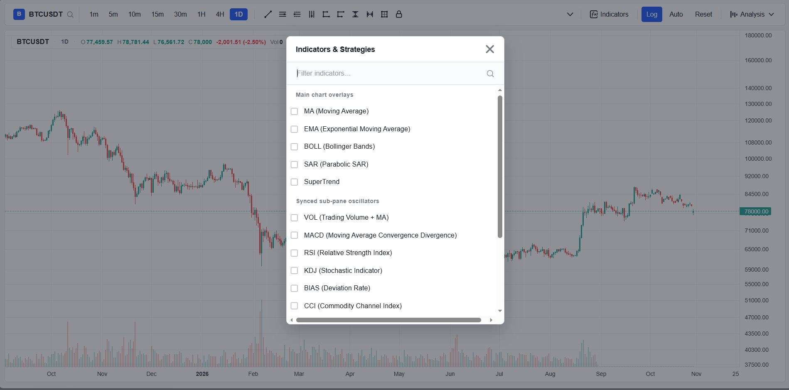
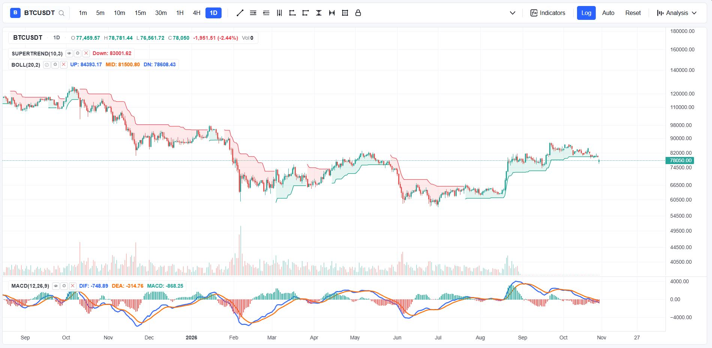

---

## 2. Quantitative & Technical Analytics
Mathematical indicator pipelines, momentum metrics, return distribution modeling, and statistical feature extraction:

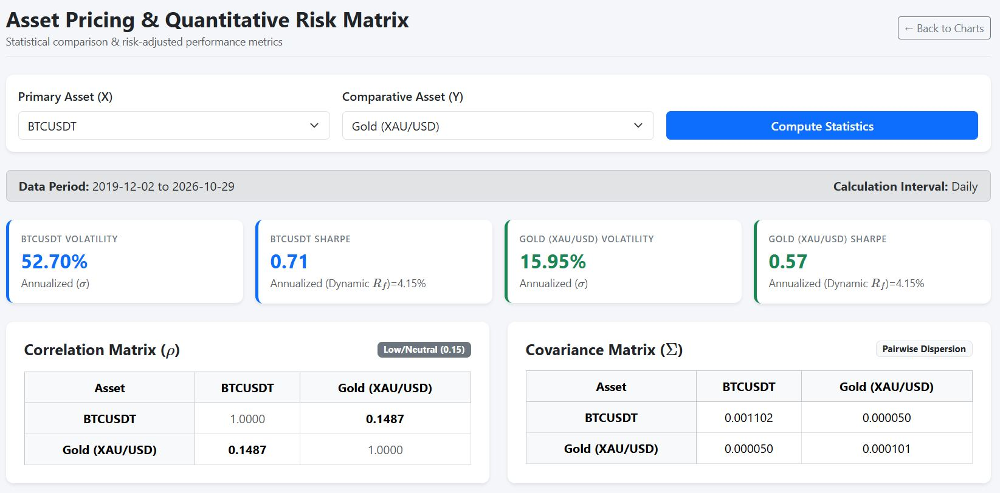
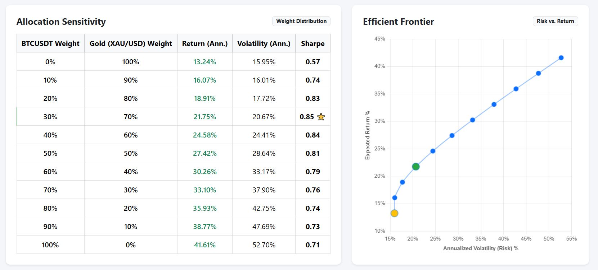
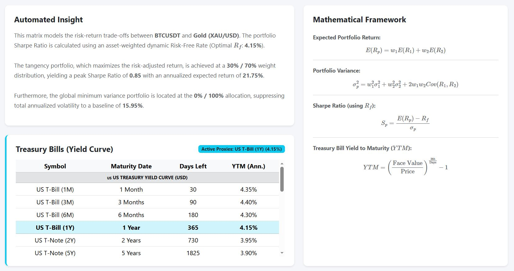
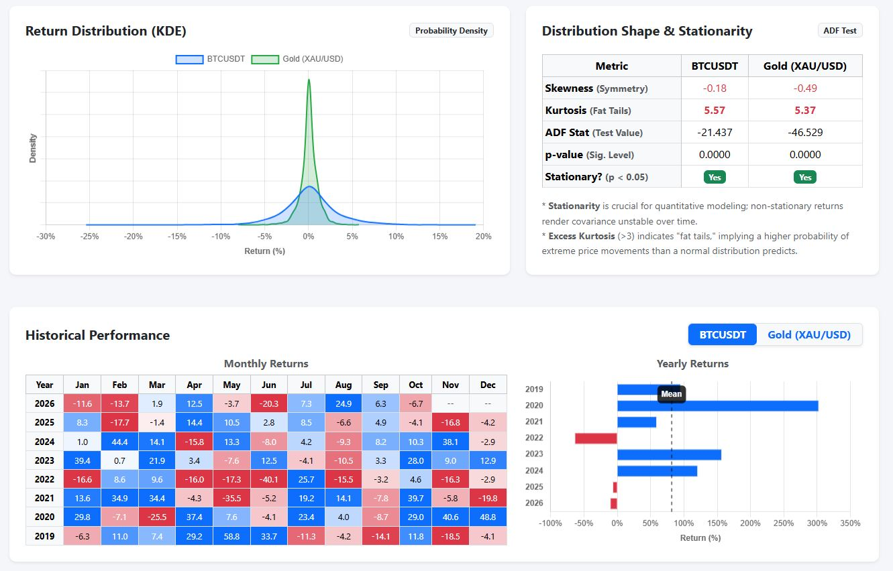
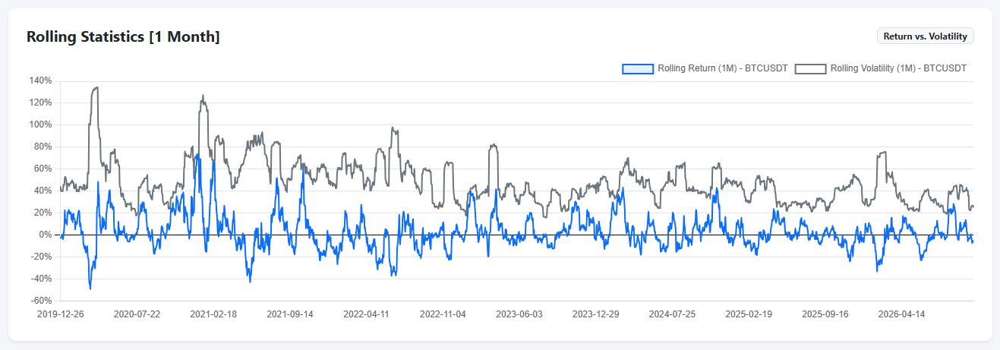
---

## 3. Fundamental Analysis & Valuation
Corporate financial statement analysis, balance sheet ratios, valuation multiples, and macroeconomic data modeling:


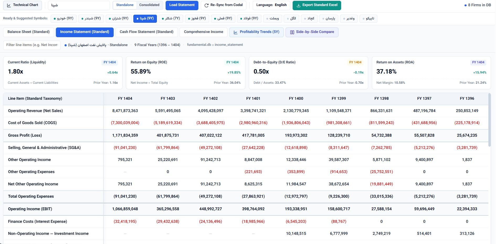
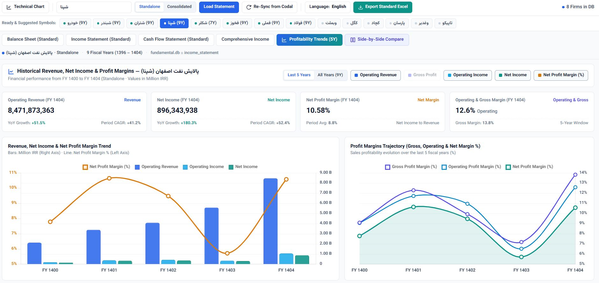
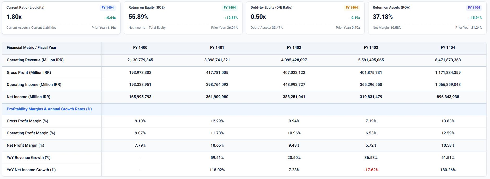
---

## 4. AI-Powered Market Insights
> ⚠️ **Status:** Under Active Development  
> An automated module utilizing agentic workflows and transformer-based models for continuous document parsing, sentiment extraction, and signal generation.


---

## Installation & Setup

1. **Clone the repository:**
   ```bash
   git clone [https://github.com/ParsaYousefnezhad/YOUR-REPO-NAME.git](https://github.com/ParsaYousefnezhad/YOUR-REPO-NAME.git)
   cd YOUR-REPO-NAME
   
2. **Set up the virtual environment:**
   ```bash
   python -m venv venv
   source venv/bin/activate  # On Windows: venv\Scripts\activate

4. **Install dependencies:**
   ```bash
   pip install -r requirements.txt
   
6. **Launch the application:**
   ```bash
   uvicorn app:app --reload